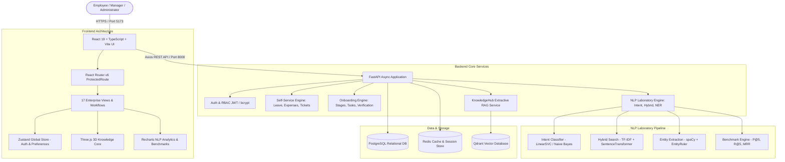

# KnowledgeHub AI — Enterprise HR & Process Intelligence Platform

[](https://fastapi.tiangolo.com/)
[](https://react.dev/)
[](https://vitejs.dev/)
[](https://www.python.org/)
[](https://scikit-learn.org/)
[](https://spacy.io/)
[](https://www.sbert.net/)
[](https://www.postgresql.org/)
[](https://qdrant.tech/)
[](https://redis.io/)
[](https://tailwindcss.com/)

An institutional-grade, conversational AI and employee process automation platform built for enterprise employees, managers, and HR administrators. KnowledgeHub AI unifies operational self-service workflows with an **advanced Natural Language Processing (NLP) Laboratory** featuring query intent routing, dual-channel hybrid information retrieval, custom entity recognition, and empirical evaluation dashboards.

---

## 📑 Table of Contents

1. [Executive Overview & Purpose](#-executive-overview--purpose)
2. [Advanced NLP Laboratory Features](#-advanced-nlp-laboratory-features)
3. [Platform Feature Matrix](#-platform-feature-matrix)
4. [Architecture & System Design](#-architecture--system-design)
5. [Technology Stack](#-technology-stack)
6. [Repository & Codebase Structure](#-repository--codebase-structure)
7. [Getting Started & Local Offline Execution](#-getting-started--local-offline-execution)
8. [API Reference Summary](#-api-reference-summary)
9. [Institutional Demo Accounts](#-institutional-demo-accounts)

---

## 🎯 Executive Overview & Purpose

**KnowledgeHub AI** eliminates friction across internal enterprise operations by unifying HR self-service, onboarding roadmaps, IT access provisioning, expense reimbursements, and statutory compliance pre-clearance into a single intelligent platform:

- **Conversational Policy RAG Assistant**: Grounded answers with verbatim citations linking directly to authoritative policy handbooks (Leave Policy, Mediclaim, Travel Policy, Code of Conduct).
- **Advanced NLP Laboratory Suite**: Real-time query intent classification (LinearSVM vs. Naive Bayes), dual-channel hybrid retrieval (TF-IDF + dense semantic embeddings), and specialized HR Named Entity Recognition (`LEAVE_TYPE`, `DURATION`, `ELIGIBILITY_PERIOD`).
- **Employee Self-Service (ESS)**: Real-time leave balance tracking, one-click leave applications, expense claim submissions, and IT equipment requests.
- **Onboarding Journey**: Structured new-hire roadmap (Day 1 to Day 90), buddy coordination, mandatory regulatory compliance tracking, and document verification.
- **Manager & HR Console**: Unified approval center for pending leaves, expense reimbursements, and candidate onboarding oversight.
- **Regulatory Compliance Shield**: Personal trading pre-clearance requests, 30-day holding window verification, and restricted list checks.

---

## 🔬 Advanced NLP Laboratory Features

The platform includes a dedicated academic NLP research module located in `backend/app/nlp/` and exposed via an interactive visual dashboard at `/nlp-lab` in the frontend:

```
┌─────────────────────────────────────────────────────────────────────────────┐
│                          KNOWLEDGEHUB NLP PIPELINE                          │
│                                                                             │
│  User Query ──► Intent Classifier ──► Hybrid Retrieval ──► NER Extraction   │
│                 (LinearSVC / NB)      (TF-IDF + SBERT)      (spaCy Ruler)   │
└─────────────────────────────────────────────────────────────────────────────┘
```

### 1. Query Intent Classification (`intent_classifier.py`)
- **Domain Routing:** Automatically classifies user inquiries into one of four administrative categories: `Leave Policy`, `Reimbursement`, `Approval Workflow`, and `Employment Policy`.
- **Feature Extraction:** Standardized text normalization (`clean_text`), unigram + bigram TF-IDF vectorization with sublinear term-frequency scaling.
- **Model Comparison:** Trains and benchmarks a generative baseline (**Multinomial Naive Bayes**) against a discriminative maximum-margin classifier (**Linear Support Vector Machine / LinearSVC** with 3-fold probability calibration).
- **Performance:** LinearSVC achieves **80.00% accuracy** and an **F1-score of 0.7936** on benchmark evaluation, outperforming Naive Bayes (+7.69% accuracy).

### 2. Hybrid Information Retrieval (`hybrid_retriever.py`)
- **Dual-Channel Fusion:** Combines sparse lexical keyword matching (Scikit-Learn TF-IDF + Cosine Similarity) with dense semantic search (Sentence-Transformers `all-MiniLM-L6-v2` generating 384-dimensional unit-normalized embeddings).
- **Convex Combination Scoring Formula:**
  $$\text{Score} = \alpha \cdot S_{\text{TF-IDF}} + (1 - \alpha) \cdot S_{\text{semantic}}$$
  Where $\alpha \in [0.0, 1.0]$ is a tunable parameter allowing dynamic weighting between exact keyword precision ($\alpha = 1.0$) and semantic comprehension ($\alpha = 0.0$).
- **Intent-Guided Filtering:** Dynamically restricts retrieval candidates to the predicted document domain to prevent cross-policy false positive hits.

### 3. Named Entity Recognition (`ner_extractor.py`)
- **Pipeline Architecture:** spaCy `en_core_web_sm` model augmented with a custom `EntityRuler` inserted **before** the statistical `ner` component with entity overwriting enabled.
- **Custom HR Concept Extraction:**
  - `LEAVE_TYPE`: Annual leave, Earned Leave, Casual Leave, Sick Leave, Maternity Leave, Paternity Leave, Comp Off, Sabbatical.
  - `DURATION`: Numerical durations and SLAs (e.g., `18 days`, `26 weeks`, `48 hours`, `3 consecutive business days`).
  - `ELIGIBILITY_PERIOD`: Qualifying timelines (e.g., `12 months`, `6 months`, `FY2026-27`, `probation period`, `Days 15–30`).
  - Standard enterprise concepts: `ORG` (regulatory bodies and portals), `MONEY`, `DATE`, `LAW`, and `PRODUCT`.

### 4. Automated Evaluation Engine (`evaluator.py` & `/nlp-lab`)
- **Benchmark Suite:** Evaluates performance against gold-standard annotated queries in `backend/data/nlp/eval_benchmark.json`.
- **Quantitative Metrics:**
  - **Retrieval:** Precision@5, Recall@5, Mean Reciprocal Rank (MRR), and Average Latency (ms) across TF-IDF, Dense Semantic, Hybrid Fusion ($\alpha=0.5$), and Hybrid + Intent Filtering.
  - **Classification:** Accuracy, Precision, Recall, Macro F1, and interactive 4x4 Confusion Matrix.
  - **NER:** True Positives, Entity Precision, Recall, and per-label breakdown.
- **Interactive Evaluation Dashboard:** Visual Recharts comparative bar charts, confusion matrix heatmaps, and live testing playgrounds accessible at route `/nlp-lab`.

---

## 🌟 Platform Feature Matrix

```
┌────────────────────────────────────────────────────────────────────────────────────────┐
│                                APPLICATION MODULES MAP                                 │
├─────────────────────────┬────────────────────────────────┬─────────────────────────────┤
│ Module                  │ Route / Component              │ Operational Focus           │
├─────────────────────────┼────────────────────────────────┼─────────────────────────────┤
│ 1. Home Dashboard       │ `/` (EmployeeDashboard.tsx)    │ Leave summary, tasks, feeds │
│ 2. AI Assistant Copilot │ `/assistant` (KnowledgeHub.tsx)│ 3D Core + Extractive RAG    │
│ 3. NLP Lab Dashboard    │ `/nlp-lab` (NLPLabDashboard)   │ Benchmarks, charts & models │
│ 4. Leave & Absence      │ `/leave` (MyLeave.tsx)         │ Balance cards, apply, cancel│
│ 5. Reimbursements       │ `/reimbursements`              │ Concur claims & summaries   │
│ 6. Service Requests     │ `/requests` (MyRequests.tsx)   │ IT hardware, IAM tickets    │
│ 7. Onboarding Portal    │ `/onboarding` (Onboarding.tsx) │ 90-day checklist & buddy    │
│ 8. HR Onboarding Admin  │ `/onboarding/hr`               │ Candidate roster & reviews  │
│ 9. Manager Approvals    │ `/approvals` (Approvals.tsx)   │ Multi-tier workflow queue   │
│ 10. Policies Catalog    │ `/policies` (ProcessViews.tsx) │ Policy dossiers & SLAs      │
│ 11. IT Access Workflow  │ `/it-access` (ProcessViews.tsx)│ ServiceHub, VPN, Bloomberg  │
│ 12. Compliance Hub      │ `/compliance` (ProcessViews)   │ Trading pre-clearance       │
│ 13. Employee Directory  │ `/directory` (ProcessViews)    │ Departmental escalation map │
│ 14. Activity Feed       │ `/activity` (MyActivity.tsx)   │ Chronological audit log     │
│ 15. Employee Profile    │ `/profile` (Profile.tsx)       │ Personal details, emergency │
│ 16. Admin Integrations  │ `/admin` (AdminIntegrations)   │ Adapter health & audit log  │
│ 17. Security & Login    │ `/login` (Login.tsx)           │ JWT session authentication  │
└─────────────────────────┴────────────────────────────────┴─────────────────────────────┘
```

---

## 🏛️ Architecture & System Design



---

## 🛠️ Technology Stack

| Layer | Technologies | Purpose |
|---|---|---|
| **Frontend Framework** | React 19, TypeScript, Vite 6 | Strict type-safety, rapid rendering & modern bundle optimization |
| **Routing & Protection** | React Router v6, ProtectedRoute | Client-side routing with role-based route guards |
| **State Management** | Zustand | Global session state, notifications, and UI preferences |
| **Styling & Theme** | Tailwind CSS, Custom Design System | Responsive dark/light theme with accessible design tokens |
| **Data Visualization** | Recharts, Lucide React Icons | NLP benchmark charts, confusion matrices, leave quotas |
| **3D Visualization** | Three.js, React Three Fiber (`@react-three/drei`) | Dynamic 3D interactive Knowledge Core visualizer |
| **Backend Framework** | Python 3.11+, FastAPI, Uvicorn, ASGI | High-throughput asynchronous REST API |
| **Data Validation** | Pydantic v2, Pydantic-Settings | Request/response schemas and environment configuration |
| **ORM & Database** | SQLAlchemy 2.0 (Asyncio), asyncpg, PostgreSQL | Fully async relational database operations |
| **NLP & Classifiers** | **scikit-learn** (v1.5+) | TF-IDF feature extraction, MultinomialNB, and LinearSVC intent routing |
| **Information Extraction** | **spaCy** (v3.8+) | Named Entity Recognition with custom HR `EntityRuler` patterns |
| **Semantic Embeddings** | **sentence-transformers** (v3.0+) | Dense 384-d embeddings (`all-MiniLM-L6-v2`) for semantic search |
| **Vector Database** | Qdrant Vector DB | High-dimensional similarity indexing and payload filtering |
| **In-Memory Caching** | Redis | Session state, token blacklisting, and precomputed benchmark caches |
| **Authentication & Security** | JWT (`python-jose`), Passlib, bcrypt | Secure authentication, password hashing, and RBAC |
| **Observability & Logging** | Structlog, SlowAPI | Structured JSON logging and endpoint rate limiting |

---

## 📂 Repository & Codebase Structure

```
knowledgehub-ai/
├── backend/                              # FastAPI Python Backend
│   ├── app/
│   │   ├── api/                          # REST API Routers
│   │   │   ├── auth.py                   # Employee login, session validation, JWT tokens
│   │   │   ├── nlp_lab.py                # NLP Laboratory endpoints (/benchmark, /classify, /retrieve)
│   │   │   ├── onboarding.py             # New-hire roadmap, tasks, document upload
│   │   │   ├── research.py               # Extractive conversational assistant, citations
│   │   │   └── self_service.py           # Leave ledger, expense claims, IT tickets
│   │   ├── core/                         # Core infrastructure
│   │   │   ├── config.py                 # Pydantic Settings configuration
│   │   │   ├── database.py               # Async SQLAlchemy engine & session factory
│   │   │   └── security.py               # Password hashing & JWT helpers
│   │   ├── models/                       # Database Models
│   │   │   └── user.py                   # User & role authentication model
│   │   ├── nlp/                          # Academic NLP Laboratory Suite
│   │   │   ├── intent_classifier.py      # TF-IDF + MultinomialNB & LinearSVC intent routing
│   │   │   ├── hybrid_retriever.py       # Convex fusion of TF-IDF and SentenceTransformers
│   │   │   ├── ner_extractor.py          # spaCy + custom EntityRuler HR pipeline
│   │   │   └── evaluator.py              # Quantitative evaluation engine (P@5, R@5, MRR)
│   │   ├── schemas/                      # Pydantic Schemas
│   │   │   ├── onboarding_schemas.py     # Onboarding task and checklist schemas
│   │   │   ├── self_service_schemas.py   # Leave, claim, and ticket schemas
│   │   │   └── schemas.py                # Base API response & auth contracts
│   │   ├── services/                     # Business Logic Services
│   │   │   ├── integration_adapters.py   # Identity, HRMS, Concur, Jira adapters
│   │   │   ├── knowledge_service.py      # HR policy RAG engine & extractive synthesis
│   │   │   ├── onboarding_service.py     # 90-day onboarding workflow state machine
│   │   │   └── self_service_service.py   # Leave balances, claims, approval logic
│   │   └── main.py                       # Application initialization & lifecycle
│   ├── data/nlp/                         # Datasets & Cached Embeddings
│   │   ├── intent_dataset.json           # 260 labeled HR queries for classification
│   │   ├── eval_benchmark.json           # 65 ground-truth benchmark test cases
│   │   ├── chunk_embeddings.npy          # Precomputed 384-d SBERT chunk vectors
│   │   └── benchmark_cache.json          # Cached evaluation metrics for instant dashboard load
│   └── requirements.txt                  # Python dependencies
│
├── frontend/                             # React 19 + TypeScript + Vite UI
│   ├── src/
│   │   ├── components/                   # UI Components
│   │   │   ├── AppHeader.tsx             # Notification center & user identity
│   │   │   ├── AppSidebar.tsx            # Navigation drawer & conversation history
│   │   │   ├── KnowledgeCore3D.tsx       # Three.js 3D interactive Knowledge Core
│   │   │   ├── ChatMessage.tsx           # Policy chat bubbles with Markdown
│   │   │   ├── CitationCard.tsx          # Verified document citation cards
│   │   │   ├── Layout.tsx                # App frame & sidebar wrapper
│   │   │   └── ProtectedRoute.tsx        # RBAC route guard
│   │   ├── pages/                        # Views & Pages
│   │   │   ├── EmployeeDashboard.tsx     # Home self-service dashboard
│   │   │   ├── KnowledgeHub.tsx          # AI Copilot conversational assistant
│   │   │   ├── NLPLabDashboard.tsx       # NLP evaluation dashboard & model playground
│   │   │   ├── MyLeave.tsx               # Leave ledger, balances, and apply
│   │   │   ├── MyReimbursements.tsx       # Expense claims & summaries
│   │   │   ├── MyRequests.tsx            # ServiceHub IT requests
│   │   │   ├── Onboarding.tsx            # Employee 90-day onboarding roadmap
│   │   │   ├── OnboardingHR.tsx          # HR & manager onboarding portal
│   │   │   ├── Approvals.tsx             # Manager approval center
│   │   │   ├── ProcessViews.tsx          # Policies, IT access, compliance views
│   │   │   ├── Profile.tsx               # Employee dossier & emergency contacts
│   │   │   ├── MyActivity.tsx            # Chronological audit log
│   │   │   └── AdminIntegrations.tsx     # Enterprise system status
│   │   ├── services/                     # Axios API Service Layer
│   │   │   └── api.ts                    # API client (Auth, NLP Lab, RAG, Self-Service)
│   │   ├── store/                        # Global State
│   │   │   └── useAppStore.ts            # Zustand store (Auth, Session, UI preferences)
│   │   ├── App.tsx                       # React Router configuration
│   │   ├── index.css                     # Tailwind CSS & theme tokens
│   │   └── main.tsx                      # App entry point
│   ├── package.json                      # Frontend dependencies & scripts
│   └── vite.config.ts                    # Vite build configuration
│
├── tests/                                # Test Suite
│   ├── test_nlp_intent.py                # Intent classifier & evaluation tests
│   ├── test_nlp_suite.py                 # Full NLP laboratory suite tests
│   ├── test_knowledge_service.py         # Policy retrieval and citation tests
│   └── test_self_service.py              # Leave, reimbursement, and approval tests
├── project_architecture_report.md        # Comprehensive system architecture & viva defense guide
└── README.md                             # Platform documentation (this file)
```

---

## 🚀 Getting Started & Local Offline Execution

The application is engineered to run **completely locally** without Docker or paid external LLM APIs (OpenAI keys are not required; retrieval and generation execute via local Scikit-Learn, Sentence-Transformers, and spaCy models).

### Prerequisites
- **Python**: v3.11 or later
- **Node.js**: v18.0 or later (v20+ recommended)
- **Git**

---

### Step 1: Clone Repository & Setup Virtual Environment

#### On Windows (PowerShell):
```powershell
# Clone the repository
git clone https://github.com/your-username/knowledgehub-ai.git
cd knowledgehub-ai

# Create a virtual environment in the backend directory
python -m venv backend\.venv

# Activate the virtual environment
.\backend\.venv\Scripts\Activate.ps1
```

#### On macOS / Linux:
```bash
# Clone the repository
git clone https://github.com/your-username/knowledgehub-ai.git
cd knowledgehub-ai

# Create a virtual environment
python3 -m venv backend/.venv

# Activate the virtual environment
source backend/.venv/bin/activate
```

---

### Step 2: Install Backend Dependencies & Language Model

Install the backend Python requirements:
```bash
pip install -r backend/app/req.txt
```
*(Alternatively, `pip install -r backend/requirements.txt`)*

Download the required spaCy English language model for Named Entity Recognition:
```bash
python -m spacy download en_core_web_sm
```

---

### Step 3: Start the FastAPI Backend Server

With your virtual environment activated, run:
```bash
# Navigate to the backend directory
cd backend

# Start the Uvicorn ASGI server
python -m uvicorn app.main:app --reload --port 8000
```

- **Interactive API Swagger Docs**: [http://127.0.0.1:8000/api/docs](http://127.0.0.1:8000/api/docs)
- **API Health Check**: [http://127.0.0.1:8000/api/v1/health](http://127.0.0.1:8000/api/v1/health)
- **NLP Benchmark Endpoint**: [http://127.0.0.1:8000/api/v1/nlp-lab/benchmark-cached](http://127.0.0.1:8000/api/v1/nlp-lab/benchmark-cached)

---

### Step 4: Start the Vite React Frontend

Open a **separate terminal** and navigate to the `frontend/` directory:
```bash
cd frontend

# Install node dependencies
npm install

# Start the Vite development server
npm run dev
```

- **Web Application URL**: [http://localhost:5173/](http://localhost:5173/)
- **NLP Laboratory Dashboard URL**: [http://localhost:5173/nlp-lab](http://localhost:5173/nlp-lab)

---

### Step 5: Run Automated NLP Verification Tests

To verify all local NLP modules and evaluations in your terminal:
```bash
python tests/test_nlp_intent.py
```

Expected output:
```
..
----------------------------------------------------------------------
Ran 2 tests in 0.240s

OK
```

---

## 📡 API Reference Summary

The FastAPI backend exposes modular REST endpoints across operational and NLP research domains:

| Method | Endpoint | Description |
|:---:|:---|:---|
| `GET` | `/api/v1/nlp-lab/benchmark` | Runs dynamic evaluation across all 65 test cases |
| `GET` | `/api/v1/nlp-lab/benchmark-cached` | Instant access to precomputed evaluation metrics |
| `POST` | `/api/v1/nlp-lab/classify` | Predict query intent using LinearSVC or Naive Bayes |
| `POST` | `/api/v1/nlp-lab/retrieve` | Run hybrid search with customizable $\alpha \in [0, 1]$ |
| `POST` | `/api/v1/nlp-lab/extract-entities`| Extract HR entities (`LEAVE_TYPE`, `DURATION`, etc.) |
| `POST` | `/api/v1/research/ask` | Extractive RAG conversational assistant with verified citations |
| `GET` | `/api/v1/self-service/leave/balance` | Query live employee leave entitlement balances |
| `POST` | `/api/v1/self-service/leave/apply` | Submit leave requests with balance validation |
| `POST` | `/api/v1/self-service/reimbursement/claims`| Submit multi-category expense claims with GST validation |
| `GET` | `/api/v1/onboarding/employee` | Retrieve 90-day onboarding state machine progress |
| `POST` | `/api/v1/auth/login` | Authenticate employee credentials and issue JWT cookies |

---

## 🔑 Institutional Demo Accounts

All credentials use generic enterprise demo profiles (`@company.com`). You can sign in using either the Employee ID or Email with the password `Password@123`:

| Role | Employee Code / Corporate Email | Password | Allowed Capabilities |
|---|---|---|---|
| **Senior Analyst** | `EMP-1001` / `aditi.sharma@company.com` | `Password@123` | Self-service, apply leaves, expense claims, AI copilot, NLP lab |
| **Quant Strategist** | `EMP-1002` / `rohan.mehta@company.com` | `Password@123` | Self-service, IT service requests, compliance pre-clearance |
| **Reporting Manager** | `EMP-1003` / `vikram.seth@company.com` | `Password@123` | Approvals center, team leave decisions, onboarding review |
| **HR Administrator** | `EMP-HR-01` / `pooja.varma@company.com` | `Password@123` | Candidate onboarding assignment, document audit, admin portal |
| **Chief Compliance** | `EMP-COMP-01` / `suresh.nair@company.com` | `Password@123` | Personal trading review, restricted securities audit |
